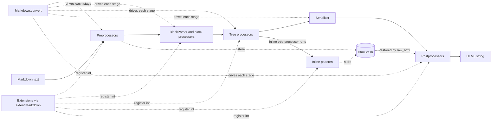

# Python-Markdown Architecture

Python-Markdown converts Markdown text to HTML through a fixed pipeline of pluggable stages. Almost all behaviour, including the core syntax, is implemented as processors registered in priority-sorted registries. Extensions add behaviour by registering more processors.

## 1. Overview

### Main components

| Component | Where | What it does |
| --- | --- | --- |
| **Markdown (orchestrator)** | `markdown/core.py` | Builds the registries, loads extensions, holds per-instance state (`htmlStash`, `references`) and runs the stages in order in `convert()`. |
| **Preprocessors** | `markdown/preprocessors.py` | Work on the document as a list of lines, before any parsing. Normalize whitespace and move raw HTML blocks into the stash. |
| **Block parser and block processors** | `markdown/blockparser.py`, `markdown/blockprocessors.py` | Split text into blocks at blank lines and offer each block to the processors in priority order. Each one builds `ElementTree` elements (headings, lists, code blocks, paragraphs) and may recurse into nested content. |
| **Tree processors** | `markdown/treeprocessors.py` | Transform the element tree. The most important one, `inline`, runs the inline patterns over element text. Others prettify whitespace and unescape. |
| **Inline patterns** | `markdown/inlinepatterns.py` | Regex-started processors for emphasis, links, images, code spans, autolinks, raw inline HTML and so on. They run only through the `inline` tree processor. |
| **Serializers** | `markdown/serializers.py` | Turn the finished element tree into an HTML or XHTML string. `output_formats` in `core.py` maps format names to serializers. |
| **Postprocessors** | `markdown/postprocessors.py` | Work on the serialized string. Restore stashed raw HTML and replace internal ampersand placeholders. |
| **Shared utilities** | `markdown/util.py` | `Registry`, `HtmlStash`, `AtomicString`, `Processor`, placeholder constants and helpers used by every stage. |
| **Extension API** | `markdown/extensions/__init__.py`, `markdown/extensions/*.py` | `Extension` is the base class for configuration and for `extendMarkdown(md)`, the hook that registers processors. Each built-in extension is one module in this package. |

### Who calls whom

`Markdown.__init__` calls `build_parser()` to create the default registries, then `registerExtensions()`, which calls each extension's `extendMarkdown(md)`. `Markdown.convert()` then runs the stages left to right, in this order:

1. **Preprocessors** run on `self.lines`.
2. **`parser.parseDocument`** produces the tree, with a root `
`.
3. **Tree processors** run on the root. A tree processor may return a replacement root.
4. **The serializer** produces a string, and `convert()` strips the top-level `
` from it.
5. **Postprocessors** run on the string.

Processor and extension modules do not depend on `core.py` at runtime: they reach the instance through the `md` or `parser` object they are given, and their imports of `Markdown` are for type checking only.

### Default processors and priorities

Higher priority runs first.

| Registry | Name and priority |
| --- | --- |
| `preprocessors` | `normalize_whitespace` 30, `html_block` 20 |
| `parser.blockprocessors` | `empty` 100, `indent` 90, `code` 80, `hashheader` 70, `setextheader` 60, `hr` 50, `olist` 40, `ulist` 30, `quote` 20, `reference` 15, `paragraph` 10 |
| `treeprocessors` | `inline` 20, `prettify` 10, `unescape` 0 |
| `postprocessors` | `raw_html` 30, `amp_substitute` 20 |
| `inlinePatterns` | `backtick` 190 down to `em_strong` 60 (see `build_inlinepatterns`) |

Examples of how extensions fit in: `fenced_code` registers a preprocessor at 25, so it runs after whitespace normalization and before raw HTML extraction. `attr_list` (8) and `toc` (5) register tree processors that run after `inline` and `prettify` have run, and `toc` sees the attributes `attr_list` has set.

## 2. Architecture decision records

### ADR-1: Priority-sorted registries instead of ordered lists

**Status: Verified.** Commit `6ee07d2`, "Replace homegrown OrderedDict with purpose-built Registry. (#688)", fixes #418.

- **Context:** Processors must run in a specific order, and third-party extensions need to place their processors relative to built-in ones. The earlier homegrown `OrderedDict` was positional.
- **Decision:** Every processor collection is a `util.Registry`. Items are registered with a name and a numeric priority and are sorted from highest to lowest when read. Registering an existing name replaces the old item.
- **Alternatives considered:** The homegrown `OrderedDict` with relative placement, which this replaced. A plain list with manual insertion is our own comparison, not one the commit discusses.
- **Consequences:** Extensions place themselves using a number, without knowing the rest of the order. Replacing a built-in is one `register` call with the same name, which `sane_lists` and `md_in_html` both use. Ordering between extensions is now implicit in the numbers, so a wrong priority produces silent misbehaviour rather than an error.

### ADR-2: Extensions as classes, discovered through entry points

**Status: Verified.** Commit `cd73243`, "Refactor Extension loading (#627)".

- **Context:** Users refer to extensions by short names such as `toc`. Earlier versions special-cased modules in `markdown.extensions` and `mdx_` prefixes, and third-party authors could only get short names by asking users to copy files.
- **Decision:** Short names are entry points in the `markdown.extensions` group, declared in `pyproject.toml`. Dotted paths (`path.to.module:ClassName`, or a module with `makeExtension()`) remain supported. `Markdown.build_extension` tries entry points first, then dotted paths.
- **Alternatives considered:** Keeping the special treatment of `markdown.extensions` and `mdx_` prefixes, both removed by this commit; making entry points the only way to load by name, which the commit message rejects ("we shouldn't 'force' entry points").
- **Consequences:** Built-in and third-party extensions load the same way. A new built-in short name only takes effect once the package is reinstalled, because entry points come from installed metadata.

### ADR-3: Protect finished HTML from later stages with a stash and placeholders

**Status: Inferred** from the code. The stash predates the commits we could find a rationale in. Commit `b701c34` (#803) confirms the related move to `html.parser` and the move of reference parsing to block processors, but does not explain the stash itself.

- **Context:** Later stages would otherwise corrupt content that is already final. Raw HTML must not be parsed as Markdown, and it cannot be represented in the element tree without being escaped by the serializer.
- **Decision:** Such content is stored in `md.htmlStash`, and a placeholder string takes its place in the text. The `raw_html` postprocessor swaps the placeholders back after serialization. For text in the tree that should simply skip inline processing, `AtomicString` marks it as final.
- **Alternatives considered:** Representing raw HTML as tree nodes and teaching the serializer about them; escaping and unescaping around each stage.
- **Consequences:** Stages can stay unaware of each other's content. Placeholders must survive every stage in between, and anything that captures output before the postprocessors run (as `toc` does for its rendered labels) has to handle placeholders itself.

## 3. Constraints

Rules a developer should not break when changing this code.

1. **Add processors only through registries, with a deliberate priority.** Use `register(item, name, priority)`, choose the number relative to the stages your processor depends on, and remember that re-using a name replaces the existing item. *See `markdown/util.py` (`Registry.register`).*
2. **New features plug in as extensions, without editing the pipeline.** An extension subclasses `Extension`, declares options in `self.config` as `key: [default, description]` before calling `super().__init__(**kwargs)`, registers its processors in `extendMarkdown`, and offers `makeExtension()`. A built-in also needs an entry point in `pyproject.toml`. *See `markdown/extensions/__init__.py`, `markdown/extensions/toc.py`, `pyproject.toml`.*
3. **Per-document state must be cleared by `reset()`, and the extension must call `md.registerExtension(self)`.** `Markdown.reset()` only calls `reset()` on registered extensions, so an unregistered extension's state silently survives between documents. Keep state on the instance, not on the module or the class. *See `markdown/core.py` (`registerExtension`, `reset`), `markdown/extensions/abbr.py`.*
4. **Follow the block processor contract.** `test()` only inspects the block and must not change anything. `run()` receives all remaining blocks: it consumes what it handles by popping from the list, and it must leave `blocks` untouched if it returns `False`, because the parser then offers the same block to the next processor. Content that spans blank lines arrives as several blocks. Nested content is parsed by calling back into the parser (`parseChunk` or `parseBlocks`), not by building HTML strings. *See `markdown/blockprocessors.py` (`BlockProcessor`), `markdown/blockparser.py` (`parseBlocks`).*
5. **Never put raw HTML into the tree as text.** The serializer escapes tree text. Output that must not be escaped or parsed further goes through `md.htmlStash.store()`, and text that only needs to skip inline processing is wrapped in `AtomicString`. *See `markdown/util.py` (`HtmlStash`, `AtomicString`), `markdown/extensions/fenced_code.py`.*
